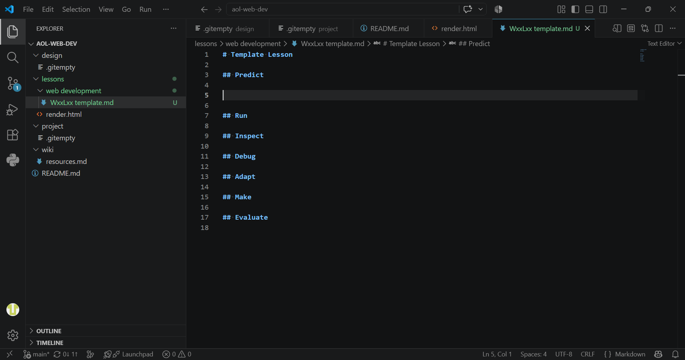
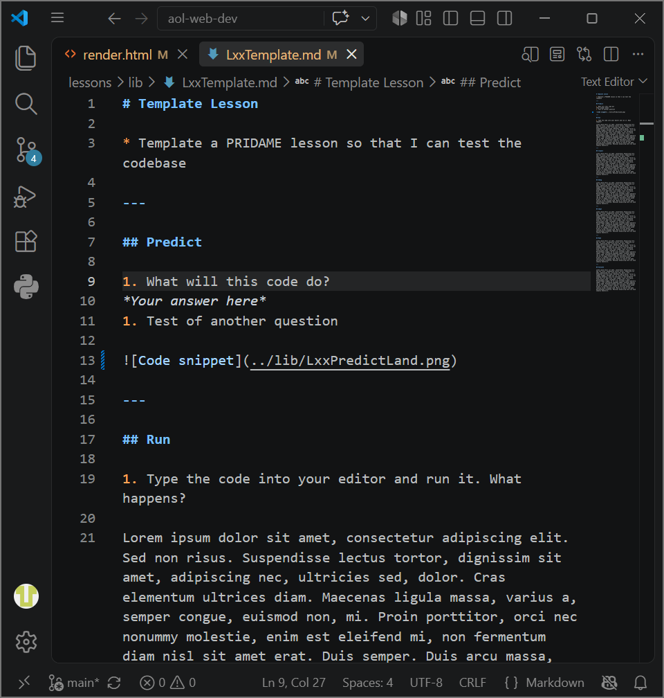

# Template Lesson

* Template a PRIDAME lesson so that I can test the codebase

---

## Predict & Run

1. What will this code do?
*Your answer here*
1. Test of another question

---

## Inspect

Lorem ipsum dolor sit amet, consectetur adipiscing elit.

---

## Debug

Lorem ipsum dolor sit amet, consectetur adipiscing elit.

---

## Adapt

Lorem ipsum dolor sit amet, consectetur adipiscing elit.

---

## Make

Lorem ipsum dolor sit amet, consectetur adipiscing elit.

---

## Evaluate

Lorem ipsum dolor sit amet, consectetur adipiscing elit.
