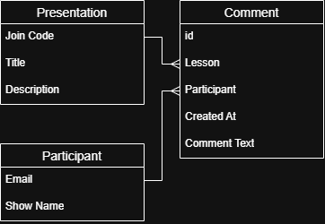

# 17 - SQLite

* Build a database using SQLite, so you can store data.
* Develop using AI assisted coding tools in an efficient and responsible manner.

---

## Predict & Run

1. Open these files in your editor.
	* [Init DB](../webdev/17_resource_init_db.py)
1. What will this code do?
	* *Your answer here.*
1. Run the code in Python.
1. How did you check it had worked?
	* *Your answer here.*
1. Was your prediction correct?
	* *Your answer here.*

---

## Inspect

1. Would it make sense for one `join code` gave access to multiple `presentations`?
    * *Your answer here.*
1. There are key words in the SQL that ensure this. What are they?
    * *Your answer here.*
1. What's the pattern between the top of my ERD tables, the SQL code and the uniqueness of the fields?
    * *Your answer here.*

---

## Inspect

1. Which direction do the crow's feet go on the ERD?
    * *Your answer here.*
1. What does the crow's foot indicate about the relationship between `presentations` and `comments`?
    * *Your answer here.*
1. Look at the SQL code for the `comments` table. What is the command that links it to the `presentations` table?
    * *Your answer here.*
1. The `comments` table needs the `presentations` table to exist first. Why is this?
    * *Your answer here.*
1. Why have I laid out the ERD with the `comments` table to the right of the `presentations` table?
    * *Your answer here.*

---

## Adapt

Now let's add a `presenter` table to our database. This will allow us to store information about the presenters of each presentation. They will be uniquely identified by their `email` address. Each presenter can give multiple presentations, but each presentation can only have one presenter.

I'm going to talk you through an AI-assisted development process that I call 'comment driven development'.

1. How does the `presenter` table relate to my existing tables?
    * *Your answer here.*
    * *Great! Add it to the ERD.*
1. What fields do you think the `presenter` table should have?
    * *Your answer here.*
    * *Great! Add them to the ERD.*
1. Where in the code should we add the `presenter` table?
    * *Put a comment in the code.*
    * *Does autocomplete create the table for you?*
    * *Does autocomplete create the relationship for you?*
    * *Update the ERD with updated field names.*
1. How did you check that this worked?
    * *Your answer here.*

---

## Evaluate

In this lesson I have discussed several professional habits that I have found useful when developing databases.
These include:
* Left-to-right layout of relationships on ERDs.
* Top-to-bottom layout of identifiers on ERDs.
* Documentation as a continuously updated resource.
* Verify your code as often as possible.

1. How do each of these help?
    * *Your answer here.*
1. How closely do you follow similar habits?
    * *Your answer here.*
