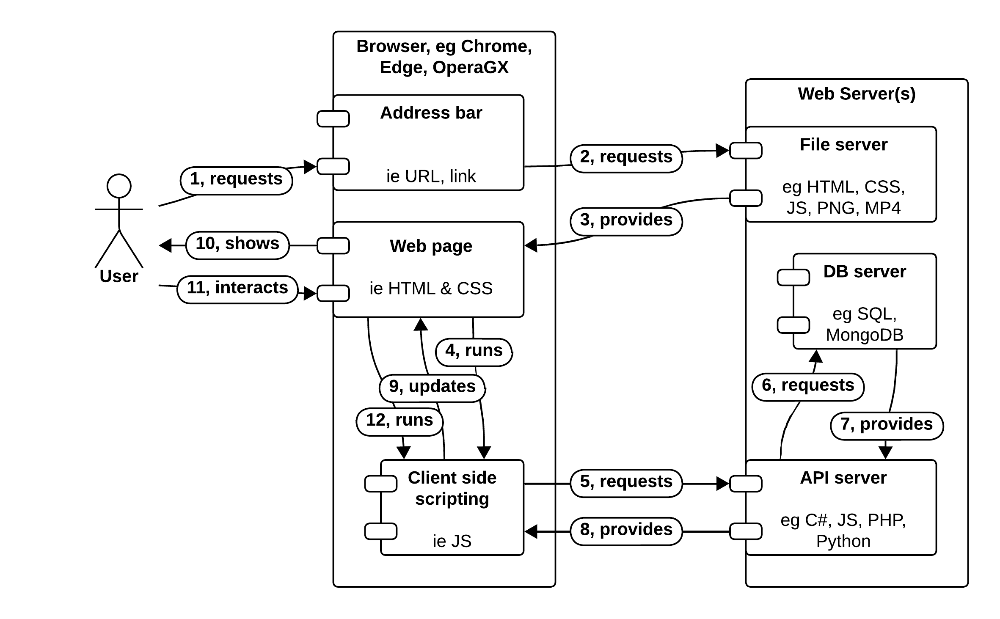

# 20 - Full Stack Map

* Describe the flow of data in a full stack website so that you can understand how the systems interact.
* Check which parts of the stack you are familiar with so that you can identify areas for learning.

---

## Predict & Run

There is no code to run in this lesson.

---

## Inspect

1. Look at the [Full Stack Map](../webdev/20_resource_map.png).
1. List the components of a full stack website.
    * *Your answer here.*
1. Describe what each component does.
    * *Your answer here.*
1. What do the numbers mean on the arrows?
    * *Your answer here.*
1. Describe what happens at each interaction.
    1. *Your answer here.*
1. Which steps might be repeated when the user interacts with the website?
    * *Your answer here.*

---

## Inspect

| CRUD                | HTTP REST           | SQL                 | Description         |
|---------------------|---------------------|---------------------|---------------------|
| Create              | *Your answer here.* | *Your answer here.* | *Your answer here.* |
| *Your answer here.* | *Your answer here.* | *Your answer here.* | *Your answer here.* |

1. What does CRUD stand for?
    * *Put them on the table.*
    * You should have a table with 4 rows.
1. What are the HTTP REST verbs?
    * *Put them on the table.*
    * You should have a table with 5 rows.
1. What are the SQL commands?
    * *Put them on the table.*
1. What does each do?
    * *Complete the description for each.*

---

## Inspect

1. So far we have considered 4 routes. What do each of them do?
    * `GET /`. *Your answer here.*
    * `GET /static/*`. *Your answer here.*
    * `GET /api/users`. *Your answer here.*
    * `POST /api/users`. *Your answer here.*

---

## Adapt

1. What is the UML diagram for this information?
    * *Your answer here.*
1. Check your answer, who did you check it with?
    * *Your answer here.*
1. Re-draw the diagram into the UML format.
    * *A link to your file here.*

---

## Evaluate

1. Look back at the map. Which parts are you familiar with? Which parts are new to you?
    * *Your answer here.*
